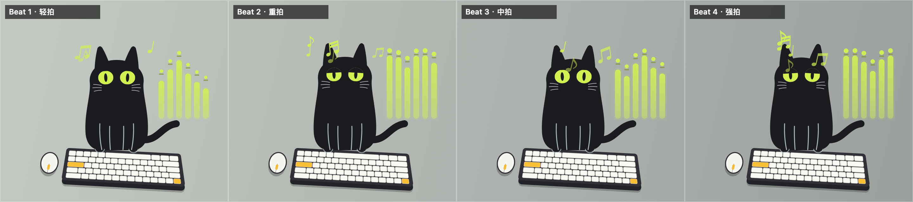
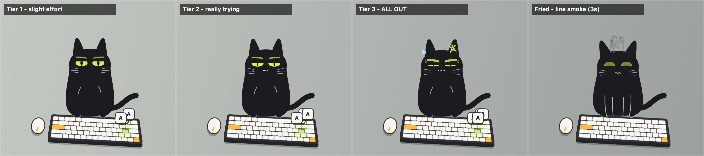
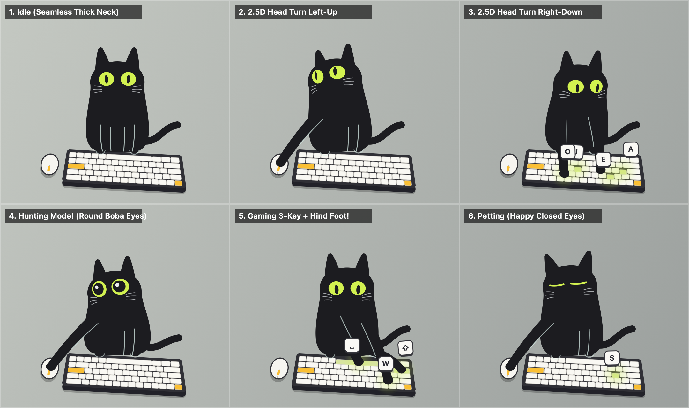
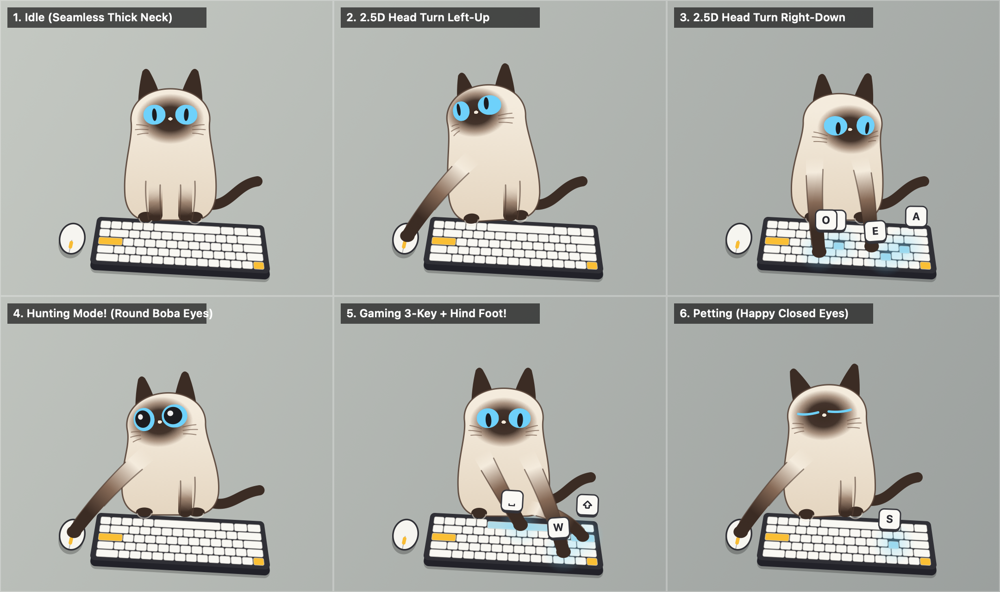
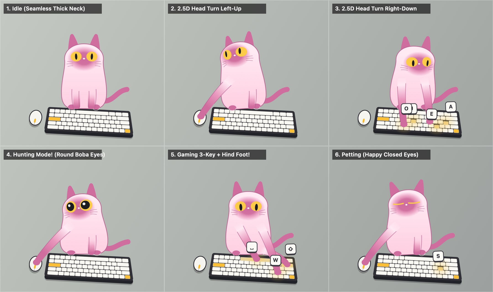
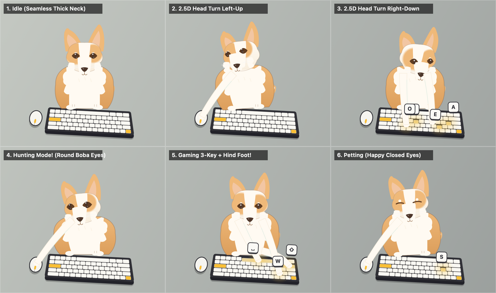
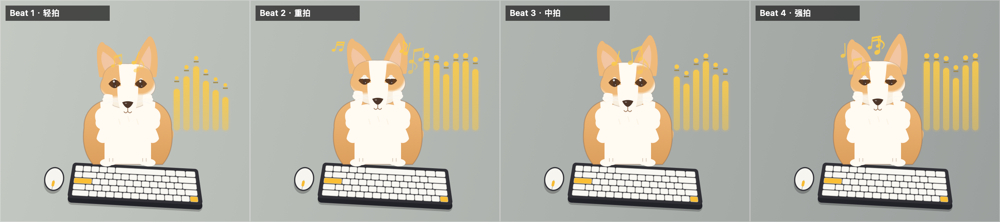
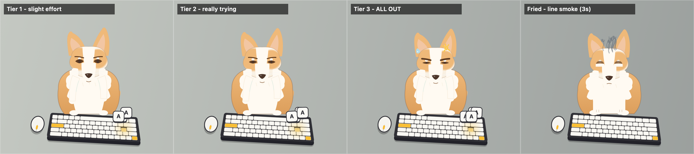

# KuroCat with Sound & Music Pulse

一只会打字的小黑猫 —— **键盘桌宠 + 按键音效 + 真实音频律动**。

本项目是在 [chanke17/KuroCat](https://github.com/chanke17/KuroCat) 的基础上衍生改造的版本，移植了 [longyijdos/KeyFoley](https://github.com/longyijdos/KeyFoley) 的按键音效引擎，并新增了由系统真实音频驱动的「音乐律动」模式。原版 KuroCat 只有视觉动画，这个版本让小黑猫打字时发出键盘声音，播放音乐时还会随节奏摆动。

> 这是个人改造的衍生项目，与 KuroCat、KeyFoley 原作者无关。

## 📸 效果预览

**音乐律动**（真实系统音频驱动的 6 段频谱光柱 + 浮动音符，四帧对比跳动）：



**打字过载彩蛋**（三档用力表情 → 停下冒烟呆滞）：



**原生动画**（打字键帽跳跃 / 2.5D 转头 / 捕猎大圆眼 / 摸头互动）：



**暹罗猫皮肤**：



**樱花小猫皮肤**（柔粉身体、玫瑰色重点色、琥珀金眼睛）：



**柯基 · 小白皮肤**（按真人形象绘制的浅奶油橘柯基；白面筋、大立耳、蓬松白胸，完整支持转头/打字/捕猎/抚摸/音乐律动/过载表情）：



柯基主题下的音乐律动与过载表情：





> 注：柯基 · 小白目前为 macOS 版专属皮肤，Windows 版暂未同步。

动态演示：[打字](docs/images/demo-typing.gif) · [捕猎](docs/images/demo-hunting.gif) · [组合动作](docs/images/demo-combo.gif)

## ✨ 相比原版 KuroCat 的改动

### 键盘音效
- **按键音效**：打字时按不同键播放对应样本（普通键 / 空格 / 回车 / 删除 / Esc / 方向键 / 修饰键）
- **7 套可切换音效主题**：剪刀脚、机械键盘、青轴 · ABS、黑轴 · PBT、经典打字机、桌面点击、铅笔笔记
- **音量控制**：静音 ～ 200%，设置自动保存在本地

### 音乐律动（Music Pulse）
- **真实音频驱动**，不是预设节奏或模拟动画：直接分析系统正在播放的声音
- **6 段实时频谱**：通过级联滤波器把音频拆成 6 个频段，驱动猫咪右侧的发光胶囊光柱
- **全身参与律动**：头部随低频起伏、耳朵抖动、开心眯眼、尾巴加速、头顶浮动音符；节拍触发时整组光柱冲高并留下缓缓回落的峰值帽
- **拾音器光柱颜色跟随瞳色主题**（黄绿色 / 暹罗蓝等自动适配）
- **完全无干扰叠加层**：音乐模式不影响打字动画与键盘音效；打字时前爪始终优先回到打字动作
- 通过菜单栏「🎵 音乐律动（拾音器 + 音符）」开关（效果见上方预览图）

### 打字过载表情（Overload Easter Egg）
- **三档递进的用力表情**：需持续高速输入（约 10 键/秒以上并保持约 1 秒）才会触发，日常聊天不会误触发；打字越快，猫咪越"较劲"——
  - 第 1 档「稍微较劲」：半睁眼、轻皱眉、抿嘴
  - 第 2 档「很努力」：眯眼竖瞳、八字眉、咬紧牙关
  - 第 3 档「拼了」：细缝眼、粗眉压低、龇牙，头上冒出怒气青筋（💢）与汗滴
- **停下即累瘫**：极速打字骤停的那一刻，猫咪头顶升起漫画式线条蒸汽，眼神呆滞涣散、嘴巴变成委屈的波浪线，持续 **3 秒**后自动恢复
- 累瘫期间**优先于音乐音符**：音符会暂时隐藏，专注表现"死机"状态；但不影响键盘音效
- 期间**移动鼠标或再敲任意键**可立即结束疲惫效果

KuroCat 原有的功能全部保留：经典小黑猫 / 挖煤暹罗猫 / **樱花小猫** / **柯基 · 小白**（macOS 专属）四种皮肤、打字键帽跳跃、2.5D 转头、捕猎大圆眼、摸头互动、全键无冲监听、鼠标穿透、开机自启、尺寸缩放等。

## 🖥️ 平台支持

| 平台 | 状态 |
|------|------|
| **macOS** | ✅ 原生 Swift 版本（universal：Apple Silicon + Intel） |
| **Windows** | ✅ 原生 C++17 / Win32 版本，功能对齐（WASAPI 音频 + Raw Input） |
| Linux | 🚧 保留原版基础桌宠端口，未同步本项目的音效/律动功能 |

Windows 端不是模拟器或 Web 包装，而是仓库内 `windows/` 下的原生 C++ 实现，使用同一套 WAV 音效主题与 6 段频谱参数：

- 按键音效：**WASAPI 渲染客户端**混合 12 声道的 16-bit PCM 样本，含软限幅与 0～200% 音量
- 音乐律动：默认播放设备的 **WASAPI Loopback** 采集 + 与 macOS 完全相同的级联滤波器/节拍检测
- 全局键鼠：**Raw Input (RIDEV_INPUTSINK)**，无需管理员权限，游戏/全屏下同样可用
- 渲染：GDI+ 矢量绘制，覆盖过载表情、冒烟、频谱光柱与浮动音符

### 系统版本要求

- **macOS 13.0+**：键盘音效、打字动画等全部基础功能
- **macOS 14.2+**：音乐律动模式（Core Audio Tap 的最低要求）
- **Windows 10 / 11**：全部功能（WASAPI Loopback 与 Raw Input）

Windows 音乐律动监听的是**默认输出设备**的混合音频；若音乐播放器切换到别的输出设备，则不会计入律动。应用点击音效会被自动做 180ms 的窗口屏蔽，避免自我喂入导致光柱乱跳。音频同样只在内存中分析，不录音、不上传。

## 📦 下载与安装

| 平台 | 直接下载 | 说明 |
|------|----------|------|
| Windows 10 / 11 | **[KuroCat-Windows-x64.zip](https://github.com/AlexGitHub0909/KuroCat-with-Sound/releases/download/v1.2.0/KuroCat-Windows-x64.zip)** | 来自 [v1.2.0 Release](https://github.com/AlexGitHub0909/KuroCat-with-Sound/releases/tag/v1.2.0)；仓库内 `windows/dist/` 也附带了同一份预编译包。解压后双击 `KuroCat.exe` 即可，无需安装或管理员权限 |
| macOS 13+ | [Releases](https://github.com/AlexGitHub0909/KuroCat-with-Sound/releases) 中的 `KuroCat-macOS-universal.zip`（若尚未提供请源码编译） | 解压后将 `KuroCat.app` 拖入「应用程序」 |

Windows 解压后请保持 `KuroCat.exe` 与 `SoundThemes` 目录在一起；包内已包含全部 7 套音效样本和第三方许可声明。

### macOS 首次授权

1. **输入监控**（打字动画 + 音效必需）：系统设置 → 隐私与安全性 → 输入监控 → 开启 KuroCat。第一次打开时会提示，授权后从菜单栏点击「重启 KuroCat」刷新。
2. **仅录制系统音频**（音乐律动必需）：打开音乐律动模式时，系统会弹出「系统音频录制」权限请求，请允许。音频**只在内存中实时分析，不会录音、保存或上传**。

> 音乐律动使用 Core Audio Tap 而不是屏幕录制，因此**不需要屏幕录制权限**，也不会出现录屏标志。macOS 可能会在控制中心显示一个系统音频使用提示，这是系统行为，无法从应用侧关闭。

Windows 版使用 Raw Input 与 WASAPI Loopback，**无需任何系统授权弹窗**；直接运行即可打字发声、开启律动。

### macOS 从源码编译

```bash
chmod +x build.sh
./build.sh
open KuroCat.app
```

编译需要 Swift 编译器与 macOS 13+ SDK，无需完整 Xcode。

### Windows 从源码编译

在 Windows 上进入 `windows/` 目录，任选一种方式：

```bat
cd windows
build.bat
```

`build.bat` 会优先使用 MSVC（请在 “x64 Native Tools Command Prompt for VS” 中运行），否则使用 PATH 中的 MinGW-w64 g++，并把 `Resources/SoundThemes` 的 7 套音效样本复制到 `KuroCat.exe` 同级目录。也可以使用 CMake：

```bat
cmake -S windows -B windows/build
cmake --build windows/build --config Release
```

运行 `KuroCat.exe` 后，右键托盘图标即可看到「🔊 按键音效」「音效主题」「音效音量」「🎵 音乐律动」等菜单，设置保存在注册表 `HKCU\Software\KuroCat`。

## ⚠️ 关于 ad-hoc 签名与权限

本项目使用 ad-hoc 签名（无 Apple 开发者证书）。**每次重新编译都会改变代码签名，导致 macOS 已授予的「输入监控」权限失效**。遇到编译安装后按键无反应、动画音效消失的情况，请到 系统设置 → 隐私与安全性 → 输入监控，将 KuroCat 的开关关闭后再打开，并重启应用即可恢复。

如果你有 Apple Development 证书，`build.sh` 会自动优先使用它签名，从而跨重编译保持权限。

## 🔊 实现来源

- **音效引擎**（播放、峰值限制、按键分类）移植自 KeyFoley 的 `Sources/KeyFoley/Sound/` 模块，并针对 KuroCat 的 `PhysicalKey` 做了适配；音效样本为 KeyFoley 内置的那 7 套主题。macOS 使用 AVAudioEngine，Windows 使用 WASAPI 渲染客户端，两边共用同一套样本与分类逻辑。
- **音乐律动**为本项目新增：macOS 基于 Core Audio Process Tap，Windows 基于 WASAPI Loopback；两端使用相同的级联滤波器、节拍检测与峰值帽参数，未使用第三方代码。
- **Windows 原生端口**位于 `windows/src/`，使用 C++17 / Win32 / GDI+ / Raw Input 实现，与 Swift 版共享设计但为 Windows API 重写，不是模拟器或 Web 包装。

## 📄 许可与归属

- **KuroCat** 原项目：MIT License，Copyright (c) 2026 chanke17 —— 见 [LICENSE](LICENSE)
- **KeyFoley** 音效引擎及样本：MIT License，Copyright (c) 2026 longyijdos
- **音效样本涉及第三方许可**（FilmCow 自定义许可、Mechvibes MIT 等）：完整声明见 [THIRD_PARTY_NOTICES.md](THIRD_PARTY_NOTICES.md)，再分发时请务必保留

本衍生项目的新增代码遵循 MIT License。原作者保留各自作品的权利，本项目不代表其立场。

## 🙏 致谢

感谢 [chanke17](https://github.com/chanke17) 和 [longyijdos](https://github.com/longyijdos) 开源了这么有趣的项目。
